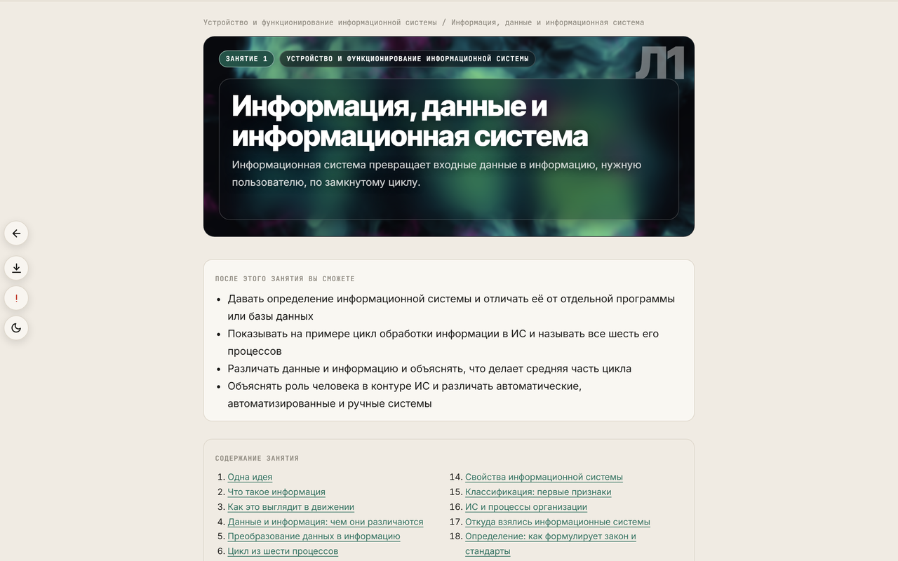
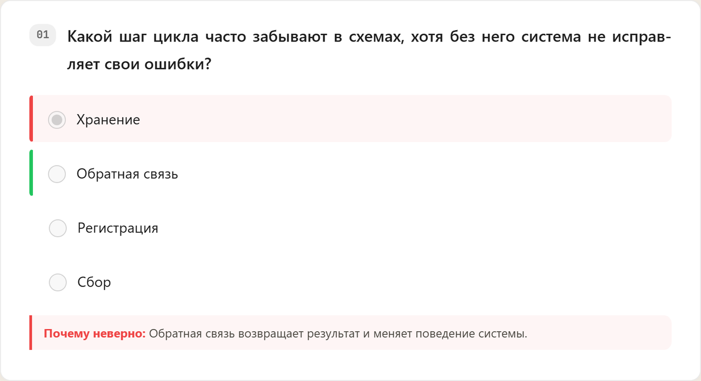
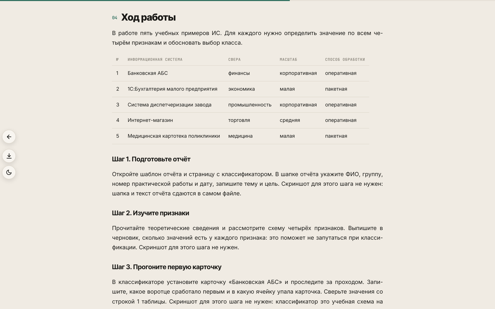
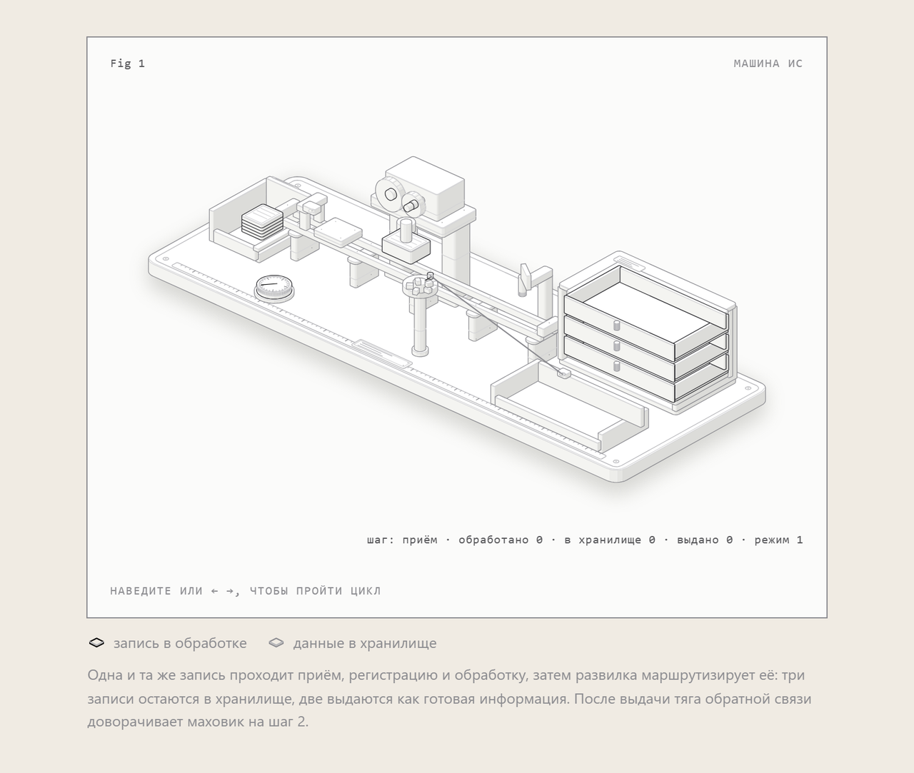
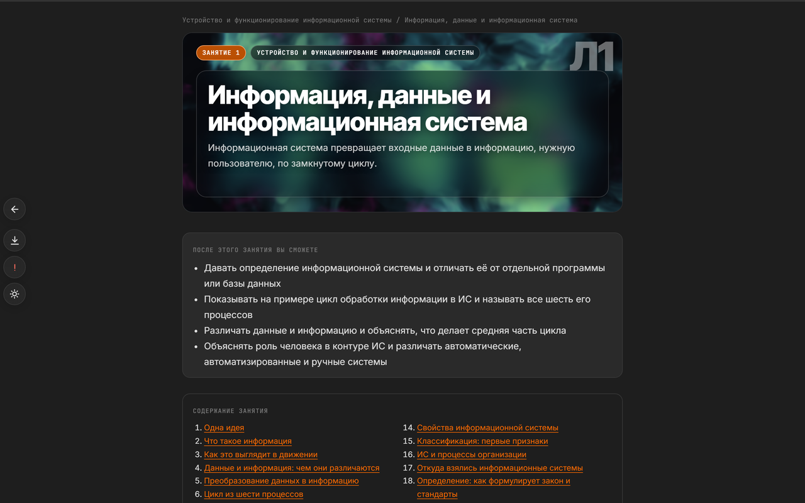
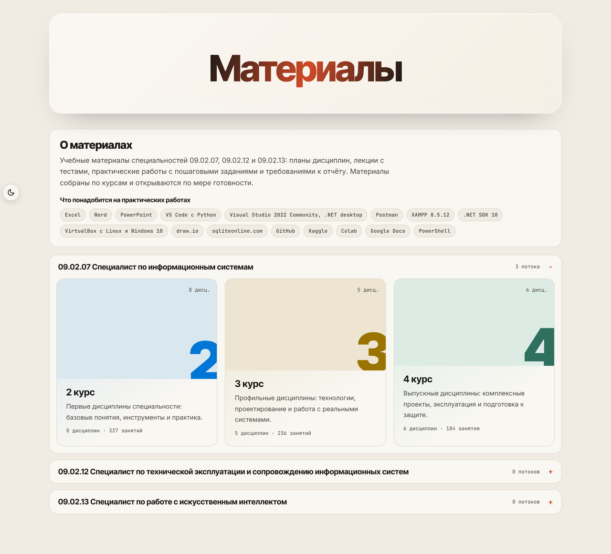
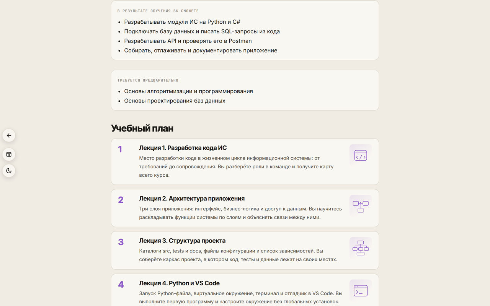

# Материалы дисциплин техникума

**Учебные материалы по специальности 09.02.07 «Информационные системы и
программирование»: планы дисциплин, лекции с тестами и практические работы.**
Это статический сайт: студент открывает ссылку в браузере, преподаватель
показывает занятие с проектора или печатает его в PDF.

### [Открыть сайт →](https://d1m40fficial.github.io/spo-it-materials/)



## Коротко

- 19 дисциплин для 2, 3 и 4 курса: 640 занятий и разделов в учебных планах,
  341 из них уже написано.
- Лекция идёт блоками: следующий открывается вопросом-воротами, а не прокруткой.
- Каждая лекция заканчивается тестом из 15 вопросов с пояснениями к ответам.
- Практика построена вокруг раздела «Ход работы»: шаги, таблицы-шаблоны,
  чек-лист выполнения, критерии оценки и шаблон отчёта.
- Сайт работает на телефоне, в тёмной теме, печатается в PDF; учебный план
  выгружается в Excel.

## Как выглядит занятие

### Лекция

Материал разбит на 2-4 смысловых блока. Первый виден сразу, остальные
открываются кнопкой с вопросом о следующем блоке. Пока блок не открыт, кнопки
перехода к другим занятиям скрыты: студент идёт по материалу по порядку.

В начале лекции: зачем она нужна, что студент сможет после неё и содержание
с ссылками на разделы. В конце: итоги и тест.

### Тест

15 вопросов на лекцию: одиночный выбор, множественный выбор и краткий ответ.
Вопросы открываются по одному, каждый следующей карточкой. После ответа
подсвечиваются верные и неверные варианты и показывается пояснение, почему
ответ верный или нет. В конце карточка с результатом, временем теста и временем
просмотра лекции.



### Практика

У практики фиксированная структура: цель, оборудование и программное
обеспечение, краткие теоретические сведения, «Ход работы», «Что сдать»,
чек-лист выполнения, критерии оценки и контрольные вопросы без ответов.



Каждая практика даёт артефакт: файл базы, скрипт, приложение, коллекцию
Postman, документ Word или презентацию. К работам приложены шаблоны отчётов.

### Фигуры

Сложные механизмы и процессы показаны интерактивными изометрическими фигурами:
их можно вращать, запускать и останавливать, проходить по шагам. Схемы, матрицы
и иерархии собраны как лёгкие SVG, которые остаются в светлой теме даже при
переключении сайта в тёмную.



### Тёмная тема и печать

Тема переключается на любой странице и запоминается. Кнопка PDF собирает
занятие в файл для печати: ворота раскрываются, служебные кнопки скрываются.
На странице плана вместо PDF стоит выгрузка учебного плана в Excel.



## Дисциплины

| Код | Дисциплина | Курс | Часы | Занятий | Готово | Состояние |
|---|---|---:|---:|---:|---:|---|
| МДК.02.01 | Технология разработки ПО | 2 | 76 | 32 | 0 | план |
| МДК.02.02 | Инструментальные средства разработки ПО | 2 | 76 | 32 | 0 | план |
| МДК.02.03 | Математическое моделирование | 2 | 76 | 32 | 0 | план |
| ОП.01 | Операционные системы и среды | 2 | 70 | 29 | 0 | план |
| ОП.02 | Архитектура аппаратных средств | 2 | 64 | 29 | 0 | план |
| ОП.04 | Основы алгоритмизации и программирования | 2 | 160 | 52 | 0 | план |
| ОП.08 | Основы проектирования баз данных | 2 | 76 | 35 | 0 | план |
| ОП.11 | Компьютерные сети | 2 | 76 | 36 | 0 | план |
| МДК.03.01 | Моделирование и анализ программного обеспечения | 3 | 64 | 26 | 4 | в работе |
| МДК.03.02 | Управление проектами | 3 | 40 | 17 | 17 | готово |
| МДК.05.01 | Проектирование и дизайн информационных систем | 3 | 128 | 50 | 50 | готово |
| МДК.05.02 | Разработка кода информационных систем | 3 | 144 | 58 | 58 | готово |
| МДК.05.03 | Тестирование информационных систем | 3 | 96 | 41 | 41 | готово |
| ДЭ-2027 | Подготовка к демо-экзамену | 4 | 40 | 9 | 9 | готово |
| МДК.06.01 | Внедрение информационных систем | 4 | 88 | 38 | 38 | готово |
| МДК.06.02 | Инженерно-техническая поддержка сопровождения ИС | 4 | 88 | 38 | 38 | готово |
| МДК.06.03 | Устройство и функционирование информационной системы | 4 | 84 | 39 | 39 | готово |
| МДК.07.01 | Управление и автоматизация баз данных | 4 | 66 | 29 | 29 | готово |
| МДК.07.02 | Сертификация информационной системы | 4 | 42 | 18 | 18 | готово |

У дисциплин с планом страницы занятий появятся по мере написания. Сколько
занятий открыто сейчас, задаёт `availability.txt`: закрытые занятия не
собираются на сайт и помечены в плане.

## Как устроен сайт

Три шага: специальность и год, затем список дисциплин, затем план дисциплины,
затем занятие. Ничего лишнего: с главной страницы видно, что уже готово, а что
ещё пишется.



План дисциплины показывает часы, систему оценивания, результаты обучения и
список занятий с иконкой темы, аннотацией и статусом. Каждое занятие открывается
одним кликом.



## Технологии

- Python и Markdown: занятие пишется как `chapter.md`, план как `course.json`,
  страницы собираются скриптом без фреймворков и базы данных.
- Один статический сайт на GitHub Pages: не нужен сервер, CMS или установка.
- Интерактив на чистом JavaScript: ворота, тест, прогресс чтения, тема, PDF.
- Фигуры Anatomy собираются в собственные HTML-файлы и встраиваются в занятие.
- Сборка детерминирована: повторный запуск не меняет `docs/`.

## Структура репозитория

```
courses/
  2/<slug>/                 дисциплины 2 курса
  3/<slug>/                 дисциплины 3 курса
  4/<slug>/                 дисциплины 4 курса
    course.json             план: карточка, результаты, список занятий
    chapters/01-lek-01/     занятие: chapter.md, figures/, отчёты
    reports/                шаблоны отчётов и данные
    dist/                   собранные страницы дисциплины
site.json                   специальности и курсы для главной
availability.txt            сколько лекций и практик открыто
docs/                       готовый сайт для GitHub Pages
assets/readme/              скриншоты для этого файла
tools/
  build_site.py             сборка сайта в docs/
  ks/                       движок страниц: глава, план, проверки
  new_discipline.py         новая дисциплина и её worktree
.opencode/skills/           скиллы для агентов: курс, фигуры, SVG
AGENTS.md                   правила разработки материалов
```

## Локальная сборка

Нужны Python 3.12+ и пакеты `markdown`, `pygments`, `pyyaml`, `python-docx`.

```powershell
$env:PYTHONUTF8=1
pip install markdown pygments pyyaml python-docx
python tools/build_site.py
```

Сайт появится в `docs/`. Одно занятие можно собрать отдельно:

```powershell
python tools/ks/scripts/build_chapter.py courses/4/uifis/chapters/01-lek-01/chapter.md
```

## Как добавить занятие

1. Добавьте запись в `chapters` файла `course.json`: номер, папку, название,
   аннотацию, минуты, иконку темы.
2. Создайте `chapters/<номер-слаг>/chapter.md` с заголовком, блоками
   `::gate ... ::/gate` и тестом `::quiz`.
3. Соберите занятие и проверьте страницу.
4. Откройте занятие в `availability.txt`, если оно должно появиться на сайте.

Правила текста, фигур и тестов описаны в `AGENTS.md` и в скилле
`.opencode/skills/course-studio/`.

## Проверка качества

Страницы проверяются в headless-браузере: ошибки JavaScript, сломанные ссылки,
горизонтальная прокрутка, пустые разделы, незагруженные фигуры, длинные тире.

```powershell
pip install playwright
playwright install chromium

python tools/ks/scripts/check_pages.py courses/4/uifis/dist
python tools/ks/scripts/check_pages.py courses/4/uifis/dist --mobile
python tools/ks/scripts/check_pages.py courses/4/uifis/dist --dark
```

## Публикация

GitHub Pages публикует папку `docs/` по адресу
**https://d1m40fficial.github.io/spo-it-materials/**.
Workflow `.github/workflows/pages.yml` собирает сайт при обновлении `main`.

## Демонстрационный экзамен

Для подготовки к ДЭ в репозитории есть отдельная дисциплина «ДЭ-2027»:
общая информация, методички по шести заданиям КИМ 09.02.07-5-2027 (БОМ 6506,
https://bom.firpo.ru/Public/6506) и варианты для практики. Задания опираются
только на доступное в кабинете ПО: Excel, Word, PowerPoint, VS Code с Python,
Visual Studio 2022, Postman, XAMPP с phpMyAdmin, VirtualBox, draw.io,
sqliteonline.com, GitHub и Colab.

## Кому это полезно

- **Преподавателям** техникумов и колледжей: готовые занятия с теорией,
  практикой и оцениванием, можно вести как есть или взять как основу.
- **Студентам**: повторение материала, самопроверка тестами, разбор практик.
- **Методистам**: пример плана дисциплины, где часы, результаты и занятия
  связаны между собой.

Материалы открыты для изучения и переработки. Если нашли ошибку или хотите
предложить занятие, создайте issue или pull request в этом репозитории.
